# ComponentLibrary2100

Bootstrap 5-style components for Rails, built with [ViewComponent](https://viewcomponent.org), Stimulus and Tailwind CSS v4. Small by design: components render semantic HTML with Tailwind utilities, take plain keyword arguments, and let you override anything.

**Status:** 0.3.0 scaffold. Components: Accordion, Alert, Badge, Breadcrumb, Button, ButtonGroup, Card, CloseButton, Collapse, Dropdown, ListGroup, Modal, Nav, Offcanvas, Pagination, Popover, Progress, Spinner, Switch, Table, Tabs, Toast, Tooltip, plus a form builder and the [extras](#extras) PageHeader, EmptyState and Avatar. Needs Ruby 3.2+, Rails 7.1+, ViewComponent 4, Tailwind v4 (`tailwindcss-rails`), importmap.

## Install

```ruby
# Gemfile
gem "component_library_2100", github: "the-codetrane/2100-component-library", tag: "v0.3.0"
```

```sh
bundle install
bin/rails g component_library_2100:install
```

The generator does three things (do them by hand if your files differ). The third is the `.gitignore` entry in step 1.

1. Adds `@import "./component_library_2100.css";` to `app/assets/tailwind/application.css`, after `@import "tailwindcss"`. That file is written by `rake component_library_2100:tailwind` (it runs automatically before `tailwindcss:build` / `tailwindcss:watch`) and points Tailwind at the gem's theme tokens and component sources. It holds an absolute path, so the generator also adds it to `.gitignore`.
2. Registers the Stimulus controllers in `app/javascript/controllers/index.js`:

   ```js
   import { register as registerComponentLibrary2100 } from "component_library_2100"
   registerComponentLibrary2100(application)
   ```

For local development: `bundle config local.component_library_2100 ../2100-component-library`.

## Use

```erb
<%= render ComponentLibrary2100::ButtonComponent.new(variant: :success, size: :lg) { "Save" } %>

<%= ui_button "Save", variant: :success %>            <%# same thing, via the helper %>
<%= ui_alert "Saved!", variant: :success, dismissible: true %>

<%= ui_card class: "w-72" do |card| %>
  <% card.with_header { "Featured" } %>
  <h5 class="mb-2 text-xl font-medium">Title</h5>
  <p>Body copy.</p>
<% end %>
```

Every component accepts the Bootstrap vocabulary it has (`variant:`, `size:`, `outline:`, `pill:`, `striped:` ...) plus any HTML attributes. A `ui_*` helper exists for every component (`ui_button_group`, `ui_list_group`, ...).

## Components

### Alert

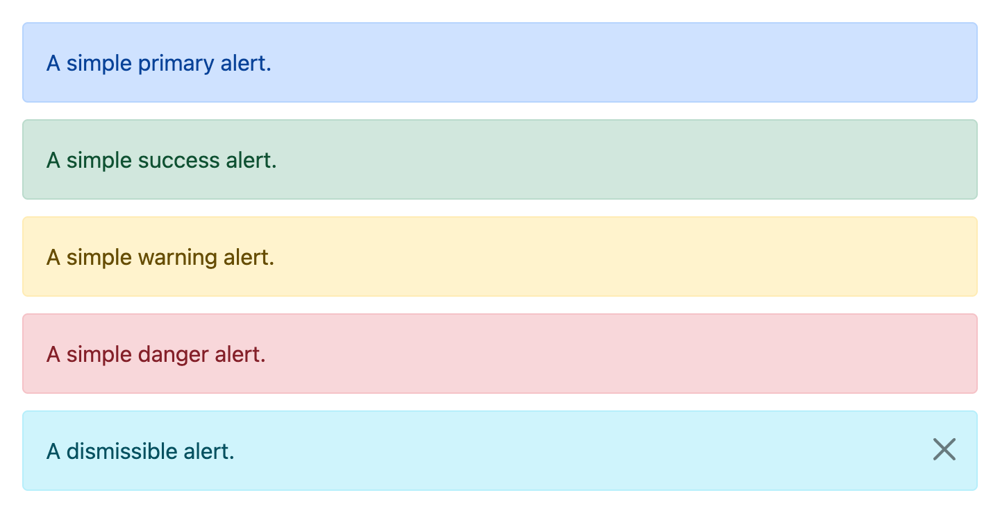

### Badge

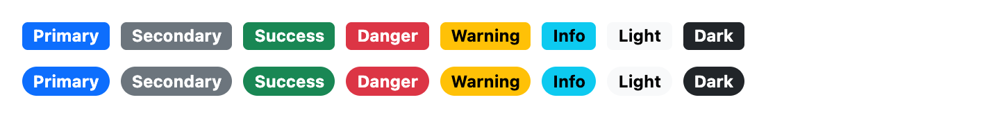

### Breadcrumb

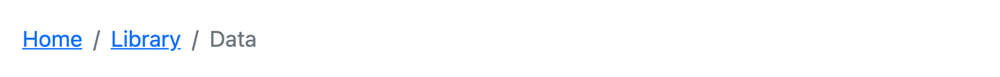

### Button

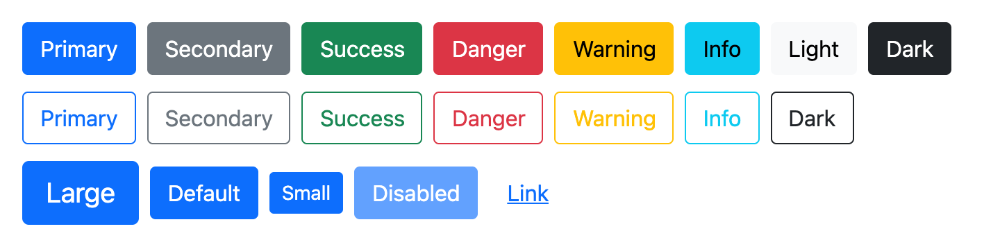

### ButtonGroup

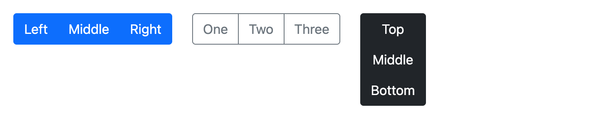

### Card

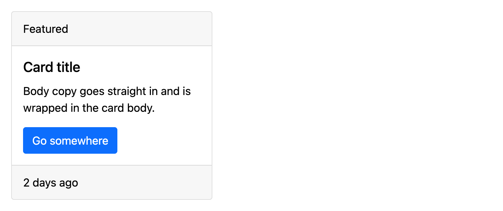

### CloseButton

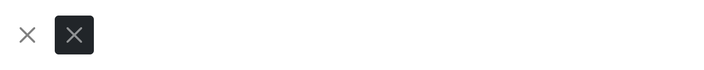

### ListGroup

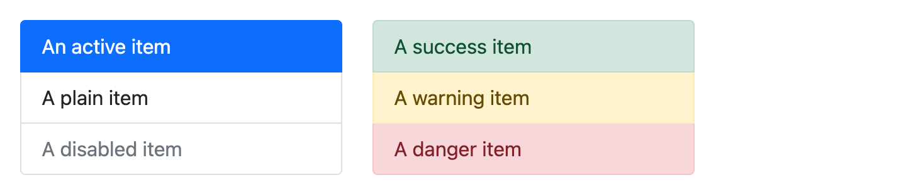

### Nav

Tabs or pills made of links, for moving between pages (TabsComponent switches panels on one page, and looks the same).

```erb
<%= ui_nav style: :pills, label: "Account" do |nav| %>
  <% nav.with_item("Profile", href: profile_path, active: true) %>   <%# aria-current="page" %>
  <% nav.with_item("Billing", href: billing_path) %>
  <% nav.with_item("Archived", href: "#", disabled: true) %>
<% end %>
```

`style:` is `:tabs` (default) or `:pills`. `fill: true` stretches the items across the width and `justified: true` makes them equal widths. `label:` wraps the list in a `<nav aria-label>` landmark; without it you get the bare `<ul>`. HTML attributes go on the `<ul>`; extra item options (`data:`, `class:` ...) go on the link.

### Navbar

The bar across the top of an app: brand, links, and actions such as an account dropdown.

```erb
<%= ui_navbar label: "Main", expand: :lg, theme: :dark do |navbar| %>
  <% navbar.with_brand(href: root_path) { "2100" } %>                <%# or with_brand("2100") for plain text %>
  <% navbar.with_item("Projects", href: projects_path, active: true) %>   <%# aria-current="page" %>
  <% navbar.with_item("Clients", href: clients_path) %>
  <% navbar.with_actions do %>
    <%= ui_dropdown(placement: "bottom-end") { |menu| menu.with_trigger { "Account" }; menu.with_item("Sign out", href: session_path, method: :delete) } %>
  <% end %>
<% end %>
```

It's a `<nav>` landmark named by `label:`. Below the `expand:` breakpoint (`:sm`, `:md`, `:lg` default, `:xl`, `:xxl`) the links move into an Offcanvas opened by a menu button, which has `menu_label:` (default "Menu") as its accessible name, `aria-controls` pointing at the panel, and `aria-expanded` kept in step by `cl-dialog`. `expand: true` never collapses; `expand: false` always does. Actions stay in the bar at every width. `theme:` is `:light` (default) or `:dark`, coloured from the `light`/`dark` tokens; the panel matches. `placement:` docks the panel (`:end` default). HTML attributes go on the `<nav>`; extra item options go on the link.

### Pagination

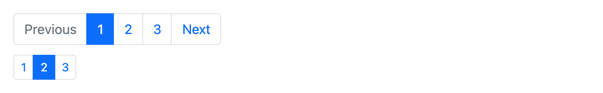

### Progress

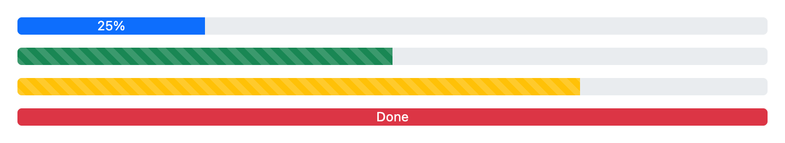

### Spinner

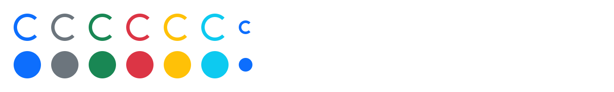

### Table

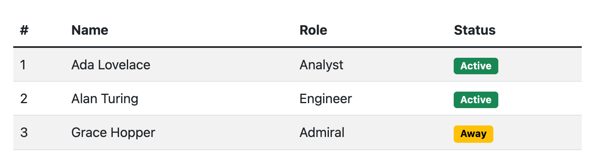

## Forms

`ComponentLibrary2100::FormBuilder` turns each field helper into a whole field: label, Bootstrap form-control styling, the model's error under the control, and a hint. `aria-describedby` and `aria-invalid` are wired for you, and `aria-invalid` is also what turns the border red.

```erb
<%= ui_form_with model: @user do |f| %>   <%# form_with(..., builder: ComponentLibrary2100::FormBuilder) %>
  <%= f.error_summary %>                  <%# lists errors, each linking to its field %>
  <%= f.text_field :name, hint: "As it appears on your ID" %>
  <%= f.email_field :email, required: true %>
  <%= f.password_field :password %>       <%# Show/Hide button (cl-password); toggle: false for none %>
  <%= f.telephone_field :phone, optional: true %>
  <%= f.number_field :age, label: "Age in years" %>
  <%= f.select :role, %w[Admin Member], {include_blank: true} %>
  <%= f.text_area :bio, rows: 4 %>
  <%= f.radio_cards :plan, [["Basic", "basic", "One project"], ["Pro", "pro", "Unlimited projects"]], columns: 2 %>
  <%= f.switch :newsletter, label: "Email me updates" %>   <%# f.check for a plain checkbox %>
  <%= f.submit "Save" %>                  <%# a ButtonComponent; takes variant:, size: %>
<% end %>
```

To use it for every form, set `config.action_view.default_form_builder = "ComponentLibrary2100::FormBuilder"`.

Every field helper (`text_field`, `email_field`, `password_field`, `telephone_field`/`phone_field`, `number_field`, `url_field`, `search_field`, `date_field`, `text_area`/`textarea`, `select`) also takes:

| Option | Does |
|---|---|
| `label:` | Label text, or `false` for none (then give the control an `aria: {label:}`). Defaults to `human_attribute_name` |
| `hint:` | Help text under the control |
| `optional:` | `true` adds "(optional)" to the label; a string changes the wording |
| `error:` | Replaces the message from `object.errors`; `false` hides it |
| `wrapper:` | HTML attributes for the field's `<div>` (`wrapper: {class: "mb-3"}`), or `false` for just the styled control |

Everything else (`class:`, `data:`, `required:` ...) goes on the control, and `class:` merges. For `select`, put these options in the options hash (the third argument), as Rails does. `rich_text_area` gets the same label/hint/error wrapper when the app has Action Text; the gem doesn't depend on it.

Pieces you can use without the builder:

- **FormField** wraps any control: `ui_form_field(label: "Email", control_id: "email", hint: "...", error: @error) { |field| email_field_tag "email", nil, **field.control_options }`. `control_options(class: ..., kind: :select)` returns the id, classes and aria attributes.
- **Switch** is Bootstrap's form-check: `ui_switch name: "user[newsletter]", label: "Email me", checked: true` (`type: :checkbox` or `:radio`, `inline: true`, `hint:`, `error:`). A switch is a checkbox with `role="switch"`. Checkboxes and switches with a `name:` include a hidden `unchecked_value:` ("0"; `false` for none), like Rails' `check_box`. HTML attributes go on the `<input>`; `wrapper:` takes the `<div>`'s. `autosubmit: true` submits the surrounding form on change (`cl-autosubmit`), for a toggle that saves itself inside a `form_with`.
- **RadioCardGroup** is a `<fieldset>` of radio cards: `ui_radio_card_group name: "plan", legend: "Plan", checked: "pro", choices: [{value: "pro", label: "Pro", description: "Unlimited"}]`. Choices can also be `[label, value, description]` arrays or strings.
- **ErrorSummary**: `ui_error_summary errors: @user.errors` (or an array of messages and `[message, href]` pairs). It renders nothing when there are no errors.

## Interactive components

These lean on the platform instead of re-implementing it, so there is little JavaScript to maintain:

| Component | Built on | Notes |
|---|---|---|
| Accordion | `<details name>` | No JavaScript. `always_open: true` drops the shared name. |
| Collapse | grid-rows transition | `cl-collapse` toggles attributes; no heights are measured. |
| Dropdown, Popover | popover API (`popover="auto"`) | Browser handles outside click, Escape and focus return; `cl-popover` places it and adds arrow-key navigation for menus. |
| Modal, Offcanvas | `<dialog>` + `showModal()` | Focus trap, inert page and Escape come from the browser. `static_backdrop: true` ignores backdrop clicks. `close:` takes CloseButton options (`close: {white: true}` on a dark panel). A trigger with `data-cl-dialog-target="trigger"` gets `aria-expanded` kept in step. |
| Tabs | WAI-ARIA tabs pattern | `cl-tabs`; tabs and panels pair by position. |
| Toast | `cl-dismiss` + `aria-live` container | Render toasts inside a `ToastContainerComponent`. `delay: 0` keeps one open. `close:` takes options for the close button, which is small by default. |
| Tooltip | popover API (`popover="manual"`) | Wrap something focusable. Shows on hover and keyboard focus. |

Dropdown items with `href:` and a non-GET `method:` render a `button_to` form inside the menu, so they submit with `_method` and the CSRF token while keeping the menu item role and arrow-key navigation: `menu.with_item("Sign out", href: session_path, method: :delete)`. `params:` and `form:` pass through to `button_to`, and `data: {turbo_confirm: "..."}` goes on the button.

Triggers are slots that take Button options: `modal.with_trigger(variant: :danger) { "Delete" }`. Open or close from anywhere inside a component with `data-action="cl-dialog#open"`, `cl-dialog#close`, `cl-collapse#toggle` or `cl-popover#close`.

Floating elements use a small placement helper (`position.js`) that flips and clamps to the viewport. It does not follow scrolling ancestors or draw arrows. It needs a browser with the popover API and `<dialog>` (all current evergreen browsers).

### Styled confirm

`data-turbo-confirm` can open a ModalComponent-style dialog instead of the browser's `confirm()`. Render the dialog once in your layout and hand the library's confirm method to Turbo:

```erb
<%# app/views/layouts/application.html.erb, inside <body> %>
<%= ui_confirm_dialog %>   <%# title: "Are you sure?", accept: "Confirm", cancel: "Cancel", variant: :danger %>
```

```js
// app/javascript/application.js
import { Turbo } from "@hotwired/turbo-rails"
import { useStyledConfirm } from "component_library_2100"
useStyledConfirm(Turbo)
```

`useStyledConfirm` sets `Turbo.config.forms.confirm` (Turbo 8) or calls `Turbo.setConfirmMethod` (older Turbo). To do it by hand, pass `confirmMethod` from the same import to either. The method returns a Promise that resolves `true` on Confirm and `false` on Cancel, Escape or a backdrop click, and falls back to `window.confirm` on a page without the dialog. A form or its submit button can set `data-turbo-confirm-title` and `data-turbo-confirm-accept` to change the title and the confirm button's text. The dialog has `role="alertdialog"` and opens with Cancel focused.

## Extras

These go beyond Bootstrap 5. They follow the same conventions (`class:` merging, HTML attributes on the root, a `ui_*` helper).

### PageHeader

```erb
<%= ui_page_header title: "Projects", subtitle: "Everything your team is working on" do |header| %>
  <% header.with_breadcrumb do %>
    <%= ui_breadcrumb { |c| c.with_item("Home", href: root_path); c.with_item("Projects") } %>
  <% end %>
  <% header.with_badge(variant: :success) { "Live" } %>   <%# BadgeComponent options; repeatable %>
  <% header.with_actions do %>
    <%= ui_button "New project", href: new_project_path %>
  <% end %>
<% end %>
```

Actions sit to the right from the `sm` breakpoint and wrap under the title on narrow screens. `level:` picks the heading tag (default `h1`). Block content renders under the subtitle.

### EmptyState

```erb
<%= ui_empty_state title: "No projects yet", text: "Projects you create appear here." do |empty| %>
  <% empty.with_icon { inline_svg_tag "folder.svg" } %>   <%# decorative; an <svg> is sized to 3rem %>
  <% empty.with_action { ui_button "New project", href: new_project_path } %>
<% end %>
```

`level:` picks the heading tag (default `h2`).

### Avatar

```erb
<%= ui_avatar name: "Ada Lovelace" %>                               <%# "AL", read out as "Ada Lovelace" %>
<%= ui_avatar name: "Ada Lovelace", size: :sm, variant: :primary %>
<%= ui_avatar initials: "AL", label: "Your account" %>
```

Initials come from the first and last words of `name:`. `size:` is `:sm` or `:md` (default); `variant:` is any colour variant (default `:secondary`). It has `role="img"` and the name (or `label:`) as its `aria-label`; with neither, it's hidden from assistive technology.

### Stepper

```erb
<%# A lifecycle: steps before current: are complete, after it upcoming %>
<%= ui_stepper label: "Project status", current: 3 do |stepper| %>
  <% %w[Draft Proposed Approved In\ progress Complete].each { |name| stepper.with_step(name) } %>
<% end %>

<%# Onboarding with links and hints %>
<%= ui_stepper label: "Getting started" do |stepper| %>
  <% stepper.with_step("Account", state: :complete, href: account_path, hint: "Done") %>
  <% stepper.with_step("Team", state: :current, href: team_path) %>
  <% stepper.with_step("Billing", state: :upcoming) %>
<% end %>

<%# Inside a form: each step is a submit button, so the form saves and moves on %>
<%= ui_stepper label: "Plan", current: 2 do |stepper| %>
  <% stepper.with_step("What", name: "step", value: "what") %>
  <% stepper.with_step("When", name: "step", value: "when") %>
  <% stepper.with_step("Who", name: "step", value: "who") %>
<% end %>
```

An `<ol>` named by `label:`. Each step's `state:` is `:complete`, `:current` or `:upcoming`; or give the stepper `current:` (the 1-based number of the current step) and leave `state:` off. The current step has `aria-current="step"`, and complete steps end with visually hidden `complete_text:` ("(completed)" by default; `nil` for none). A step is plain text, a link (`href:`) or a submit button (`name:` and `value:`); other options (`form:`, `disabled:`, `data:` ...) go on that element. `hint:` adds a line under the label, tied to a link or button with `aria-describedby`. Steps sit in a row from the `md` breakpoint and stack below it; `vertical: true` always stacks.

## Overriding

| Need | How |
|---|---|
| One-off style change | `class:` is merged with `tailwind_merge`, so `class: "px-8 rounded-full"` replaces the defaults instead of fighting them |
| Extra attributes | `id:`, `data:`, `aria:` etc. are passed to the root element. `data-controller` values are concatenated with the component's own |
| Theme (colours, radius) | Redefine tokens after the import: `@theme { --color-primary: #7c3aed; --radius-ui: .5rem; }` |
| New variant | Add its `--color-<name>*` tokens to `@theme`, then add a line to the tables in `Variants` (classes must be written out in full for Tailwind to see them), or pass `class:` per call |
| Custom Tailwind classes in merges | `ComponentLibrary2100.merger = TailwindMerge::Merger.new(config: {...})`. Keep the radius names from `ComponentLibrary2100::MERGER_CONFIG` in your config |
| Small behaviour change | Subclass: `class AppButton < ComponentLibrary2100::ButtonComponent` |
| Full control | `bin/rails g component_library_2100:eject button` copies the component into your app, where it shadows the gem's |

## Reserved theme tokens

`engine.css` defines these `--color-*` tokens for `primary`, `secondary`, `success`, `danger`, `warning`, `info`, `light` and `dark`:

| Token | Used for |
|---|---|
| `--color-<name>` | Solid fills, so it needs to be dark or bright enough to carry `-on` text |
| `--color-<name>-on` | Text on a solid fill |
| `--color-<name>-subtle` | Tinted surfaces |
| `--color-<name>-border` | Borders on tinted surfaces |
| `--color-<name>-emphasis` | Text on tinted surfaces |

It also defines `--radius-ui`, `--radius-ui-sm` and `--radius-ui-lg`, and these neutral greys, set to Bootstrap 5.0's values:

| Token | Default | Used for |
|---|---|---|
| `--color-body` | `#212529` | Text in tables, cards, menus, dialogs, form controls |
| `--color-body-muted` | `#495057` | Active tab text, list group action text |
| `--color-border` | `#dee2e6` | Table rules, tab and modal dividers, pagination, radio cards, upcoming Stepper markers and connectors |
| `--color-border-subtle` | `#e9ecef` | Tab hover borders |
| `--color-border-input` | `#ced4da` | Form control borders |
| `--color-border-translucent` | `rgb(0 0 0 / 0.125)` | Card, list group and accordion edges |
| `--color-border-menu` | `rgb(0 0 0 / 0.15)` | Dropdown menu edge and divider |
| `--color-border-overlay` | `rgb(0 0 0 / 0.2)` | Modal, Offcanvas and Popover edges |
| `--color-surface-muted` | `#e9ecef` | Menu and pagination hover, disabled controls, progress track |
| `--color-surface-tint` | `rgb(0 0 0 / 0.03)` | Card header and footer |
| `--color-surface-stripe` | `rgb(0 0 0 / 0.05)` | Striped table rows |
| `--color-surface-hover` | `rgb(0 0 0 / 0.075)` | Hovered table rows |

Override them in your `@theme` to retint every component at once. The translucent ones darken whatever is behind them. White backgrounds (`bg-white`), backdrops, Tooltip, Toast and a few one-off shades are not tokens yet.

Your own `@theme` wins over these, so a token with the same name but another purpose changes the components. A pale `--color-success` meant for borders makes success buttons unreadable. Give those tokens other names.

## Differences from Bootstrap

- No outer margins (`mb-3` etc.): spacing is the caller's job.
- Hover on solid buttons uses `brightness-90` rather than a computed shade. It stays when you pass a `hover:bg-*` class, so that color comes out 10% darker. Add `hover:brightness-100` to cancel it.
- Responsive tables use Tailwind's breakpoints.
- Not included: Bootstrap's grid, utilities, Reboot or Sass. Tailwind covers those.

## Development

```sh
bundle install
bundle exec rake test
bundle exec rubocop
```

Tests boot a tiny in-process Rails app (`test/test_helper.rb`) and render each component with `ViewComponent::TestCase`.

The images above come from `bundle exec rake screenshots`, which renders the examples in `script/screenshots.rb` and writes `docs/images/`. It needs Chrome installed. Rerun it after changing how a component looks.

CI runs on every PR: the tests on each supported Ruby and on the oldest gem versions the gemspec allows (`gemfiles/oldest.gemfile`, so keep the two in step), RuboCop, `bundler-audit`, a gem build and a workflow audit. A weekly run repeats this against the latest gems and opens an issue if it fails.

### Merging

Once CI is green, `bin/pr-triage` merges a PR into `development` unless one of these applies. Nothing reaches an app until a person bumps the version.

- **It's sensitive:** it touches `lib/`, `config/`, `app/javascript/`, `.github/`, the gemspec, or another path in `SENSITIVE` in `script/review_policy.rb`. It gets the `needs-human-review` label, and the required **Human review** check stays red until a person adds `human-reviewed`. A new push takes that label off, so review again after pushing. After adding the label, wait for **Human review** to turn green, because GitHub blocks the merge until it does.
- **It's labelled `do-not-auto-merge`:** it stays open, and **Human review** stays red until the label comes off. This includes drafts, which otherwise merge like any other PR.
- **It's from a fork:** it never merges itself.

### Releasing

Add notes to `## Unreleased` in `CHANGELOG.md` as you go. To release, open a PR that changes `VERSION` in `lib/component_library_2100/version.rb`, renames `## Unreleased` to the new version, adds a fresh `## Unreleased` above it, and updates the tag in the install instructions. CI fails the PR if the notes are missing. Merging it runs CI again, then creates the tag and GitHub Release. Tags can't be moved or deleted, so a fix goes out as a new version.

## Roadmap

Carousel, and tokens for the remaining one-off shades (white surfaces, backdrops, Tooltip, Toast).

## License

MIT. See [LICENSE](LICENSE).
